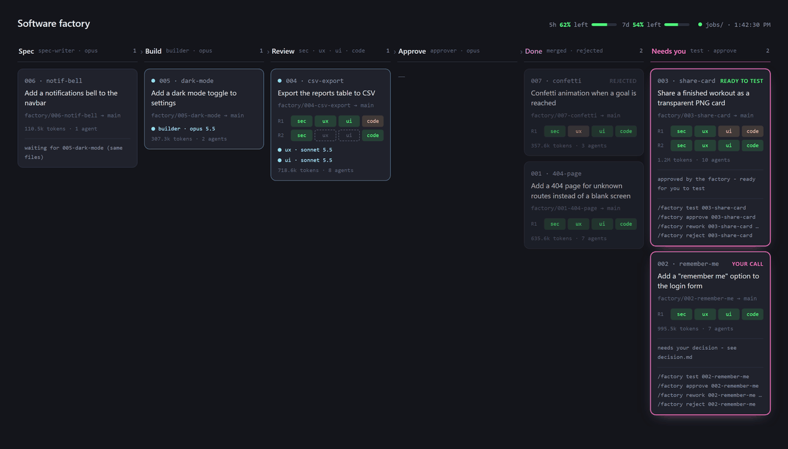
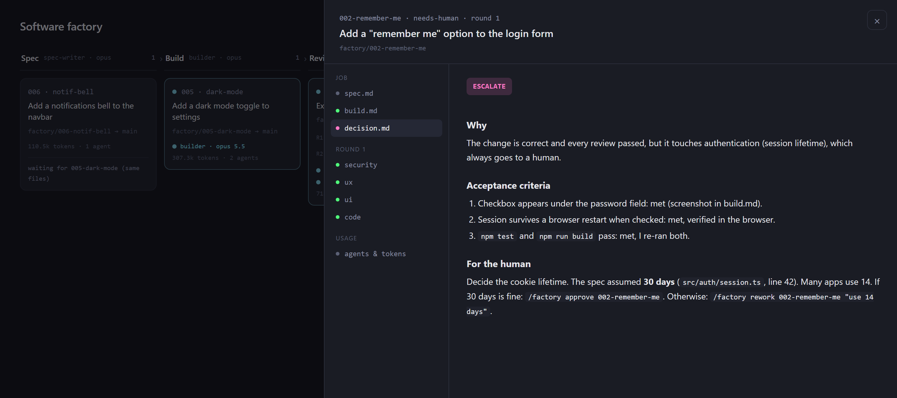
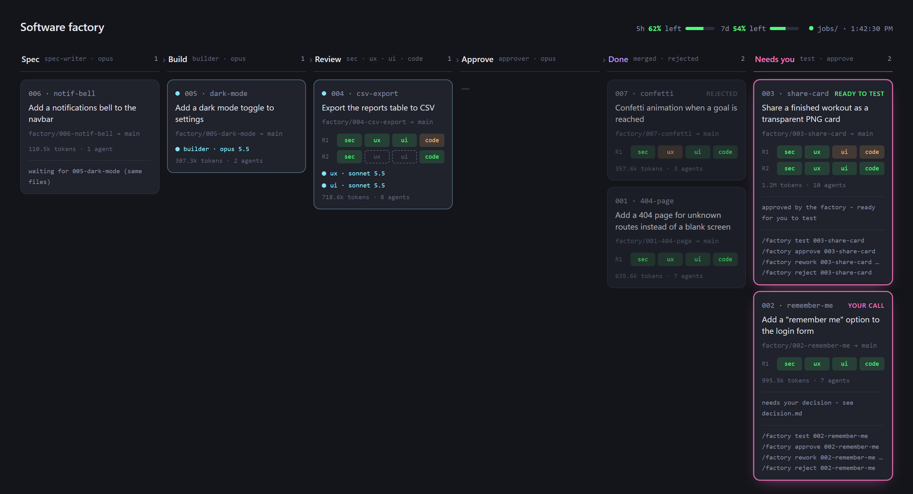
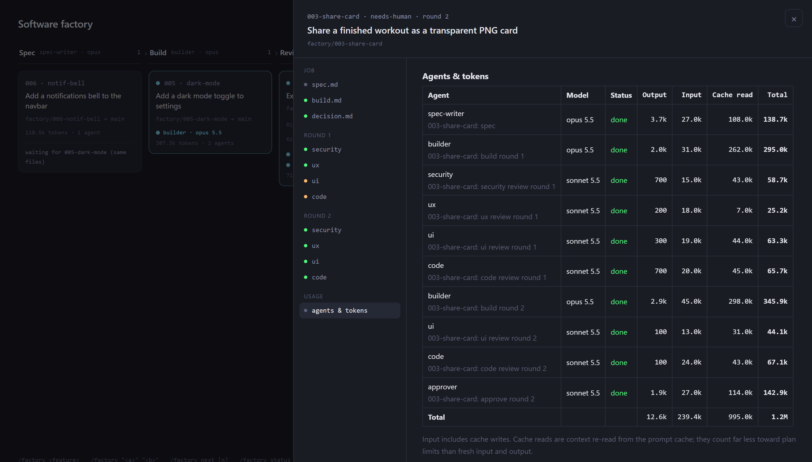

# Factory

A software factory for Claude Code, maintained by **DevJom**.

Type `/factory <feature>` and a team of AI agents writes a spec, builds the feature
in its own worktree, reviews it from four angles (security, UX, UI, code), and
hands it to you to test. **Nothing reaches your main branch until you approve it.**



```
feature → spec-writer → builder → [security, ux, ui, code] → approver → you test → merge
             opus         opus      opus  sonnet sonnet sonnet   opus
                           ▲                    │
                           └── any CHANGES ─────┘  (fix and re-review, max 2 times)
```

## Contents

- [How it works](#how-it-works)
- [Install](#install)
- [Step by step: your first feature](#step-by-step-your-first-feature)
- [A normal day](#a-normal-day)
- [Scenarios](#scenarios)
- [Dashboard](#dashboard)
- [Commands](#commands)
- [Saving cost](#saving-cost)
- [Credits](#credits) · [License](#license)

## How it works

| Step | Agent | What it does | Writes |
|---|---|---|---|
| 1 | **spec-writer** | Reads your code and turns your one-line request into requirements and testable acceptance criteria | `spec.md` |
| 2 | **builder** | Implements the spec on its own branch, in its own worktree, runs your tests, commits | `build.md` + commits |
| 3 | **4 reviewers** (in parallel) | security, UX, UI design and code quality each answer `PASS` or `CHANGES` | `round-N/review-*.md` |
| 4 | *fix loop* | Any `CHANGES` → the builder fixes them and all reviewers check again (at most 2 extra rounds) | |
| 5 | **approver** | Checks every acceptance criterion and the risk. `APPROVE` = ready for you to test; `ESCALATE` = needs your decision | `decision.md` |
| 6 | **you** | Test it, then approve, send it back, or reject it | |

Agents talk to each other through these files, not through chat, so every step is
saved in `.factory/jobs/<job-id>/` and you can read exactly why something passed.

Each job gets its **own copy of your project** (a git worktree) on its own branch, so
several features can be built at the same time without touching your folder:

```
myapp/                         ← your folder: untouched while jobs run
myapp-factory/001-dark-mode/   ← job 1 builds here (branch factory/001-dark-mode)
myapp-factory/002-search-bar/  ← job 2 builds here (branch factory/002-search-bar)
```

If Orca is running, the worktrees are created through
Orca instead and each job shows up as a card in Orca's sidebar with live status.

## Install

Requires [Claude Code](https://claude.com/claude-code), git and Node.js.
Optional: Orca, and [`agent-browser`](https://github.com/vercel-labs/agent-browser)
(lets the builder and UX/UI reviewers look at your running app).

**macOS / Linux**

```bash
git clone https://github.com/DevJom/factory-skill ~/.claude/skills/factory
mkdir -p ~/.claude/agents && cp ~/.claude/skills/factory/agents/*.md ~/.claude/agents/
```

**Windows (PowerShell)**

```powershell
git clone https://github.com/DevJom/factory-skill "$HOME\.claude\skills\factory"
New-Item -ItemType Directory -Force "$HOME\.claude\agents" | Out-Null
Copy-Item "$HOME\.claude\skills\factory\agents\*.md" "$HOME\.claude\agents\"
```

Start a **new** Claude Code session so it loads the skill.

**Optional: show your plan's remaining quota on the dashboard.** Add a status line
to `~/.claude/settings.json` (Pro/Max plans). If you already have a status line,
append `--then "<your current command>"` so it keeps working:

```json
"statusLine": { "type": "command", "command": "node ~/.claude/skills/factory/scripts/statusline.js" }
```

On Windows use the full path: `node \"C:/Users/<you>/.claude/skills/factory/scripts/statusline.js\"`.

## Step by step: your first feature

**1. Prepare the project (once).**

```bash
cd my-project
git add -A && git commit -m "clean start"   # the factory needs a clean, committed project
```

In Claude Code, run `/init` once if the project has no `CLAUDE.md`. Every agent
reads it to learn how to install, run, test and lint your project. This is the
single biggest improvement in quality *and* cost.

**2. Open the live board (optional).**

```
/factory dashboard
```

Open the URL it prints (`http://127.0.0.1:8765/dashboard.html`) and leave it open.

**3. Ask for a feature.** Be specific and put your decisions in the request.

```
/factory add a "back to top" button that appears after scrolling down one screen
```

You'll see one line per step:

```
001-back-to-top: spec written
001-back-to-top: built, round 1 review started
001-back-to-top: round 1 → sec PASS, ux PASS, ui PASS, code PASS
001-back-to-top: approver APPROVE → ready to test
```

**4. Test it yourself.**

```
/factory test 001-back-to-top
```

It starts the job's dev server on its own port, gives you the URL, the changed
files and the acceptance criteria as a checklist. If you change anything while
testing, commit it inside the job's worktree and it becomes part of the feature.

**5. Decide.**

```
/factory approve 001-back-to-top                       # merge into main, clean up the worktree
/factory rework 001-back-to-top "show it after 2 screens, not 1"   # send it back
/factory reject 001-back-to-top                        # drop it (the branch is kept)
```

**6. Push when you're ready.** The factory never pushes.

```bash
git push
```

## A normal day

```
morning   /factory hello     → what got done, what's waiting for you, what was interrupted, a suggested plan
day       /factory test / approve / next / "<feature>" ...
evening   /factory bye       → summary, follow-up ideas for the backlog (you choose), plan for next time
```

`hello` and `bye` write a short journal in `.factory/journal/`, so tomorrow's
`hello` picks up exactly where `bye` left off.

## Scenarios

<details>
<summary><b>1. One simple feature</b> (the normal path)</summary>

```
/factory add a 404 page for unknown routes
```

Spec → build → 4 reviews all `PASS` → approver `APPROVE` → **ready to test**.
Run `/factory test 001-404-page`, try it, then `/factory approve 001-404-page`.
</details>

<details>
<summary><b>2. The approver escalates ("your call")</b></summary>

```
/factory add a "remember me" option to the login form
```

Even with every review passing, anything touching login, permissions, payments,
database migrations, deploy/CI config, new dependencies, email or product decisions
is **escalated**. `decision.md` tells you exactly what to decide:



Then either `/factory approve 002-remember-me` (it asks you to confirm) or
`/factory rework 002-remember-me "use 14 days"`.
</details>

<details>
<summary><b>3. You test it and don't like it</b></summary>

```
/factory rework 003-search-bar "search after 2 letters, not on Enter; show 'No results' when empty"
```

A fresh builder reads your note plus the whole history, fixes it, and all four
reviewers check again. It comes back as **ready to test**. Small fix you'd rather
do yourself? Edit and commit inside the job's worktree, then `/factory approve`.
</details>

<details>
<summary><b>4. Bad idea: drop it</b></summary>

```
/factory reject 004-confetti
```

It asks you to confirm, removes the worktree and keeps the branch in case you change
your mind (`git branch -D <branch>` deletes it for good).
</details>

<details>
<summary><b>5. Several features at once</b></summary>

```
/factory "add dark mode toggle" "add CSV export to the reports page"
```

Each feature gets its own worktree and branch and they build at the same time (up to
3 at once; more wait in a queue). Test and approve them in any order. You can also
open several Claude sessions in the same project and run `/factory next` in each.
</details>

<details>
<summary><b>6. Two features that touch the same files</b></summary>

```
/factory "redesign the navbar" "add a notifications bell to the navbar"
```

After both specs are written: `002-notif-bell: overlaps with 001-navbar → waiting for 001`.
The second job builds on top of the first once you approve it, so there's no conflict.
If they were started from different sessions and do conflict, `/factory approve`
tells you; run `/factory rework <id> "merge main and resolve the conflicts"`.
</details>

<details>
<summary><b>7. A queue of work (backlog)</b></summary>

Add items to `.factory/backlog.md`:

```markdown
- [ ] Add a 404 page for unknown routes
- [ ] Show the last login time on the profile page
- [ ] Add pagination to the incidents list
```

Then `/factory next` (one) or `/factory next 3` (three in parallel). Each item is
checked off with its job id. `/factory bye` also suggests backlog items from the
day's review notes; you pick which to add.
</details>

<details>
<summary><b>8. The builder gets stuck</b></summary>

```
001-export-pdf: builder BLOCKED - the spec doesn't say which page to export,
and adding a PDF library is a dependency decision.
```

Answer with a rework: `/factory rework 001-export-pdf "export the report page; use jspdf"`.
</details>

<details>
<summary><b>9. Reviewers are still unhappy after 3 rounds</b></summary>

The job stops at **needs you** with the outstanding findings. Read the last round's
reviews on the dashboard, then give precise direction with `/factory rework`
(this resets the round limit), fix it yourself in the worktree, or reject it.
</details>

<details>
<summary><b>10. Backend-only change (cheaper)</b></summary>

When the spec says nothing visible changes and the diff has no front-end files, the
UX and UI reviews are skipped automatically: only security and code review run.
</details>

<details>
<summary><b>11. Your main branch isn't <code>main</code></b></summary>

```bash
git config factory.base develop
```

Jobs branch from `develop` and merge back into it.
</details>

<details>
<summary><b>12. You closed Claude in the middle of a job</b></summary>

```
/factory resume
```

It lists interrupted jobs and continues from the last saved step (for example,
re-running only the reviewers that hadn't finished). `/factory hello` also lists them.
</details>

<details>
<summary><b>13. <code>approve</code> refuses to merge</b></summary>

| Message | What to do |
|---|---|
| main checkout is busy or not on main | Switch your project folder to main and commit or stash your own work |
| worktree has uncommitted edits | You edited files while testing: commit them in the job's worktree, or discard them |
| conflicts with main | `/factory rework <id> "merge main and resolve the conflicts"` |
| worktree removal failed | The merge already happened. Close the editor or dev server using that folder, then remove it |
| another merge is running | Wait a few seconds and run approve again |
</details>

## Dashboard

`/factory dashboard` serves a live board from `.factory/` (it polls every 2 seconds):



- **Columns:** Spec → Build → Review → Approve → Done → **Needs you**.
- **Cards:** the feature, its branch, one row of review chips per round
  (green `PASS`, orange `CHANGES`), the agent working on it right now, and its token total.
- **Header:** your plan's remaining 5-hour and 7-day quota.
- **Click a card** to read every file of the job (spec, build notes, each review,
  the decision) and the **agents & tokens** breakdown:



Link straight to a job with `dashboard.html#<job-id>` or `#<job-id>/__agents`.

## Commands

```
/factory <feature>                 build one feature
/factory "feature A" "feature B"   build several in parallel
/factory next [n]                  build the next item(s) from .factory/backlog.md
/factory status                    all jobs at a glance (also: /factory with no arguments)
/factory test <job-id>             run a finished job and try it
/factory approve <job-id>          merge it into your base branch (never pushes)
/factory rework <job-id> "<note>"  send it back with your feedback
/factory reject <job-id>           drop it
/factory resume [job-id]           continue a job whose session closed
/factory dashboard                 live board with quota and tokens
/factory hello | hi | morning      daily briefing
/factory bye | goodbye [notes]     daily summary, backlog suggestions, journal
```

## Saving cost

Each job runs 6 to 15 agents, so:

- **One feature per job, small and specific.** "Add CSV export to the reports page" works;
  "improve the reports" doesn't.
- **Put your decisions in the request** (limits, library, wording) so the spec doesn't
  have to guess and the approver doesn't have to escalate.
- **Have a `CLAUDE.md`** (`/init`), so agents don't rediscover your commands every time.
- **Watch the dashboard's tokens** to see which jobs and roles cost the most.
- Start with one job before running three in parallel.

Planned improvements (size/risk-based model and effort routing, re-reviewing only
what changed, a quota guard, a slimmer orchestrator) are tracked in [`TODO.md`](TODO.md).

## Files

```
SKILL.md                 the orchestrator (/factory)
agents/factory-*.md      the seven agents (install into ~/.claude/agents/)
assets/dashboard.html    the board, copied into each project's .factory/
scripts/serve.js         dashboard server with quota and token APIs
scripts/statusline.js    status line that records plan quota (can chain an existing one)
docs/                    screenshots
TODO.md                  improvement backlog
```

In each project, the factory keeps its state in `.factory/` (jobs, backlog, journal,
dashboard). It's added to git's local exclude file, so it never shows up in your commits.

## Credits

- **Original author:** [ZazenCodes](https://github.com/zazencodes), the
  "Software Factory for Claude Code"
  ([zazencodes-season-3/src/software-factory-claude-code](https://github.com/zazencodes/zazencodes-season-3/tree/main/src/software-factory-claude-code)):
  the original loop, the seven agent roles and their review checklists, and
  the first version of the dashboard.
- **Modified and improved by:** DevJom, 2026.

### What DevJom changed and added

- Installed globally instead of copied into each repo; per-project state in a git-ignored `.factory/`.
- **Human test gate:** the factory never merges on its own (`/factory test`, `/factory approve`).
- **Orca worktrees** with live card status; plain git worktrees otherwise.
- **Parallel jobs from one session**, overlap warnings and holds, a merge lock, and a
  conflict check that sends the builder to sync with the base branch.
- Configurable base branch, Windows path handling, UX/UI reviews skipped for non-visual changes.
- New commands: `test`, `reject`, `resume`, `status`, `dashboard`, `hello`, `bye`.
- **Dashboard:** plan quota, live agents per job, tokens per job and per agent, deep links.
- Cost-reduction plan in `TODO.md`.

## License

DevJom's modifications and additions are released under the MIT License (see
[`LICENSE`](LICENSE)). Portions from the original ZazenCodes software factory remain
the work of ZazenCodes; the original repository does not include a license.
